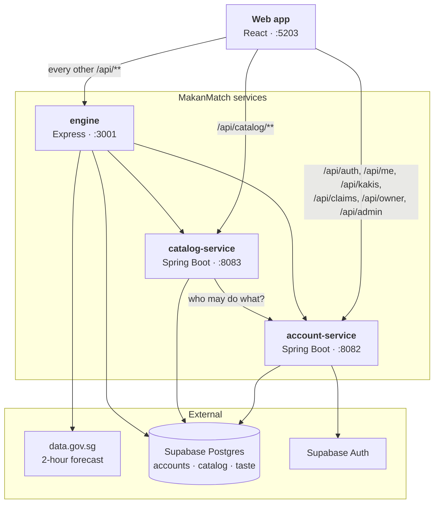

# MakanMatch

**Singapore food discovery that learns your taste.**

Rate what you eat and MakanMatch learns what you like. Every rating, head-to-head
comparison and written review updates your personal *Taste DNA*, which then ranks
~21,700 real Singapore food venues by how well each one suits you. The app explains
every recommendation. Venue owners keep their own listings accurate, and admins
verify who owns what.

A CS203 team project at SMU.


## Contents

- [What it does](#what-it-does)
- [How it works](#how-it-works)
- [Tech stack](#tech-stack)
- [Repository layout](#repository-layout)
- [First-time setup](#first-time-setup)
- [Running the tests](#running-the-tests)
- [Useful commands](#useful-commands)
- [Troubleshooting](#troubleshooting)
- [Project status](#project-status)
- [Contributing](#contributing)
- [Data sources](#data-sources)

## What it does

### For diners

The app has five tabs along the bottom: **For you**, **Kakis**, a raised **+** for
**Review**, **Taste DNA** and **Me**. The top bar shows the weather and your
avatar, and the logo appears on a splash screen while your session loads.

- **Where you are**: For you searches from SMU until you change it. Tap **Change**
  to use your phone's location, search a place, MRT station or postcode (OneMap),
  or pick an area, and choose a 10, 20 or 30-minute walk. The choice stays in your
  browser; it's never saved to your account.
- **Find me a restaurant**: the ten best matches within that walk. Each
  one has a match score, a confidence level and "why" chips explaining the score.
- **Surprise me**: one pick from a cuisine your Taste DNA hasn't explored yet.
- **Live context**: when data.gov.sg forecasts rain where you are, the feed re-ranks towards
  sheltered venues. Venues closed right now drop out, with the reason shown.
- **Other people's reviews**: reviews from people with a taste like yours move your
  matches. If most of them found a place too spicy and you keep the spice low, it
  drops for you and its card says why; places pushed out of your top 10 are listed
  below it. Open **Map · reviews** on a card to read its reviews, tap a name to
  compare that person's taste with yours, and see your kakis' recent eats on **Kakis**.
- **Dietary dealbreakers**: if you eat halal, you only see venues our data tags
  halal. If you're vegetarian or vegan, meat-only places (steakhouses, BBQ, chicken
  rice...) drop out and vegetarian places get a small boost.
- **Kakis**: add the people you eat with by username; they accept your request.
  Save groups of them, like "Thursday lunch crew".
- **With friends**: switch For you to "With friends", pick kakis or a group, and
  get places scored for everyone at once (see below).
- **Review**: search every venue, pick a dish (or add one the menu is missing)
  and rate it. You give it a sentiment, settle up to three head-to-head duels
  against dishes you've already ranked, and can add a written review.
- **Taste DNA**: the learned profile, with six taste dimensions, per-cuisine
  affinities and a model-accuracy meter that climbs as its predictions improve.
- **Makan Pet**: an otter on For you that grows with a review a day and faints if
  you miss one. Minimise it to a small pill if it's in the way.
- **Me**: your details (display name, username and dietary needs: restrictions,
  preferences and spice level), password and the venues you run, plus Reset my
  taste and Log out.

### For venue owners

Any diner can claim a venue by submitting proof, and an admin approves the claim.
Owners then get **My venues** in the Me tab, where they can:

- post status updates: open as usual, closed for now, closed for good, or moved
  (with the new address);
- set weekly opening hours, including split sessions and hours past midnight;
- edit the whole menu and its official prices in one table, or start from a
  photo of the printed menu;
- resolve price conflicts when diners report paying something different.

### For admins

Admins get **Admin tools** and **View as** in the Me tab, and a **Demo** button in
the top bar.

- approve or reject venue claims, and revoke ownership;
- promote and demote admins, and disable accounts;
- use **View as** to see the app as a diner or an owner. The server applies that
  role's permissions for real, so it is a genuine test;
- open **Demo** to show the app reacting: simulate rain, take back a review bomb,
  and move Makan Pet's day forward. The button says how many are switched on, so
  nothing is left on after a rehearsal;
- drop a **review bomb** on any place with a menu from its card (**Review-bomb this
  place**): three seeded spice-shy accounts post real "too spicy" reviews, and the
  place drops for diners with a taste like theirs. One place at a time; set up once
  with `seed:personas` and `seed:review-bomb -- --prepare`;
- set their own taste by hand on **Taste DNA → Edit**: sliders, set all cuisines to
  0, or reset to a new account. It's their real taste, and until their next review
  Find builds its taste embedding from the sliders.

"Owner" isn't a stored role: an account is an owner when it manages at least one
venue. Owners can't review their own venues. An admin's own claim is approved at once,
since admins can approve any claim anyway.

## How it works

### Architecture



| Service | Responsibility | Folder |
|---|---|---|
| **account-service** | Sign-up and login (on Supabase Auth), profiles, roles, kakis and saved groups, venue ownership claims, admin tools | [`account-service/`](account-service) |
| **catalog-service** | The venue registry (Overture Maps plus curated seeds), owner status reports, opening hours, dishes, price history, menu-photo scans | [`catalog-service/`](catalog-service) |
| **engine** | Recommendations, venue search, reviews, rankings and the learned Taste DNA | [`demo/server/`](demo/server) |
| **web app** | Every screen | [`demo/src/`](demo/src) |
| **context-service** | OneMap walking times and NEA weather, with rain-adjusted ranking. When it runs (as on Vercel) the engine gets the weather from it ([details](context-service/README.md)) | [`context-service/`](context-service) |

The code follows three rules:

- **Each service owns one database schema** and never reads or writes another's.
- **Services call each other in one direction only**: catalog → account, and
  engine → account + catalog. Inside each Spring service, controllers call
  services, services call repositories, and features never depend on each other
  in a circle. An ArchUnit `ArchitectureTest` enforces this.
- **The browser sees a single origin.** In development, Vite's proxy routes each
  `/api/...` path to the right service. In production, the host's rewrites do the
  same job. This is what lets the refresh cookie be `SameSite=Strict`.

### How recommendations work

The engine scores every venue for the signed-in diner:

```
score = 50 + cuisine affinity − avoided-cuisine drag
           + spice, richness and price fit   (where known, or where reviews say)
           + taste-vector similarity
           ± what reviews from people like you say
           − distance − recent-cuisine fatigue ± context (rain, mood)
```

Two principles shape it:

- **A venue can't claim a match the data doesn't support.** The score is capped
  by how many of the venue's attributes are known and how many reviews it has.
  A barebones listing can't show a 99% match.
- **The scoring is the explanation.** Every term that applies emits a
  human-readable chip, such as *"Similar to places you've rated well"* or
  *"Sheltered - good in this rain"*.

Taste DNA learns from three channels: the sentiment you pick, each head-to-head
duel (treated as a preference pair), and your written reviews, which are matched
against your own past reviews. For the taste-vector term, each venue gets a
sentence embedding (all-MiniLM-L6-v2, built offline, so the server runs no model
at request time). The engine compares it with the average embedding of venues you
rated above 5/10. [`demo/README.md`](demo/README.md) has the full formula and
walks through each screen.

**Other people's reviews.** Reviews from the last 30 days count for you by how close
the reviewer's taste is to yours (spice, richness, price, adventure and cuisines),
how recent they are and how much the reviewer has reviewed. Together they shift
what the app believes about a venue's spice and richness, by at most 0.7 of the
scale and less while the evidence is thin, and nudge the score by up to 12 points.
When that moves a card by 3 or more, the card says so and names who. A cuisine at
or near 0 drags its places down by up to 30 points ("You avoid turkish").

**Eating with kakis.** Each person at the table scores every venue with their own
Taste DNA, and a venue's group score is the average. Nobody should be stuck
somewhere they'd hate, so the engine aims for everyone at 75% or more. Only if
that leaves fewer than three places does it lower the bar, 5 points at a time
(never below 50), and the screen says so. Anyone's halal or vegetarian needs
apply to the whole table; the screen says how many places that left out, never
whose needs they were. account-service checks that everyone picked really is
the diner's kaki before the engine sees their Taste DNA.

### Security at a glance

- **Passwords never touch our code or database.** Supabase Auth stores and checks
  them.
- **Tokens:** the access token (about 1 hour) is kept only in page memory. The
  refresh token lives in an `HttpOnly`, `SameSite=Strict` cookie scoped to
  `/api/auth` and rotates on every use.
- **Every service verifies tokens itself**: the ES256 signature against
  Supabase's published keys, plus expiry, issuer and audience. Roles come from
  our database, not the token, so promoting, demoting or disabling an account
  takes effect within 30 seconds everywhere.
- **Reviews are visible to every signed-in user**: a place's reviews, and a
  reviewer's recent reviews and five taste dimensions on their profile. Nothing else
  leaves the engine (not the before-snapshot kept for undo, dietary needs or emails);
  account-service's `GET /api/people` returns only id, display name and username,
  and leaves out disabled accounts.
- **The review bomb signs in as the three demo accounts** with
  `SEED_PERSONA_PASSWORD` from `.env`, and as no one else. Leave it unset outside
  a demo.
- **Guard rails:** login throttling, one generic message for failed logins,
  venue claims need an admin (an admin's own claim goes through at once), and the
  last active admin can't be removed.

## Tech stack

| Layer | Technology |
|---|---|
| Web app | React 18, Vite 5, Leaflet with OpenStreetMap tiles |
| Engine | Node.js 20, Express 4, `jose` (JWT verification), `pg` with pgvector, PGlite for tests |
| Account and catalog services | Java 17, Spring Boot 4.1, Spring Security (OAuth2 resource server), Spring Data JPA, Flyway, springdoc-openapi, ArchUnit |
| Context service | Spring Boot 4.1, Caffeine cache, OneMap routing API, NEA forecast API |
| Platform | Supabase (Postgres and Auth) |
| Offline data tools | DuckDB (Overture Maps extraction), transformers.js (venue embeddings) |

## Repository layout

```
.
├── account-service/   Spring Boot: accounts, roles, claims, admin
├── catalog-service/   Spring Boot: venues, status reports, hours, menus, prices
├── context-service/   Spring Boot: walking times and weather
├── demo/
│   ├── server/        Express recommendation engine
│   └── src/           React web app
├── scripts/           venue extraction and loading, seeding, dev service runner
├── .github/           commit message conventions
└── .env.example       every setting the services read, with placeholder values
```

## First-time setup

### Prerequisites

- **Node.js 20.12+**
- **JDK 17+**, with `JAVA_HOME` pointing at it (for example
  `winget install EclipseAdoptium.Temurin.17.JDK` or
  `brew install --cask temurin@17`). You don't need to install Maven: each
  Spring service ships with its own wrapper.
- A free **Supabase** project (Singapore region)

### 1. Install

```bash
git clone https://github.com/justins-github/MakanMatch-CS203.git
cd MakanMatch-CS203
npm install
```

`npm install` also installs the web app and engine dependencies in `demo/`.

### 2. Configure

```bash
cp .env.example .env
```

Fill in the Supabase URL, the API keys and the database connection. The comments
in [`.env.example`](.env.example) say where to find each value in the Supabase
dashboard. Use the **session pooler** connection, because the direct connection
is IPv6-only on the free tier. You don't need to create any tables: each service
creates its own schema on first start.

`.env` is gitignored. Never commit it.

### 3. Run

```bash
npm run dev
```

This starts account-service, catalog-service, the engine and the web app in one
terminal. The first start downloads Maven and the Spring dependencies, which takes
a few minutes.

| What | Where |
|---|---|
| Web app | http://localhost:5203 |
| account-service API docs | http://localhost:8082/swagger-ui.html |
| catalog-service API docs | http://localhost:8083/swagger-ui.html |
| Engine health check | http://localhost:3001/api/health |

### 4. Load the venue data (once)

In a second terminal, with `npm run dev` still running:

```bash
npm run load:venues
npm run seed:menus
```

Optionally, build the venue taste vectors. This takes about 2 minutes plus a
one-time ~23 MB model download. Without them, ranking simply skips the similarity
term.

```bash
node scripts/embed-venues.mjs
npm run upload:vectors
```

### 5. Make yourself an admin

Sign up in the app, then run:

```bash
node scripts/seed-accounts.mjs --promote you@example.com
```

Refresh, and **Admin tools** appears in the Me tab. From then on, admins promote each
other in the app.

### Optional: the demo community

Set `SEED_PERSONA_PASSWORD` in `.env`, then run:

```bash
npm run seed:personas
```

```bash
npm run simulate
```

The first command creates the demo community: four diners with distinct tastes,
four spice-shy accounts for the review bomb (Sam, Wei Ling, Hafiz and Nadia), two
owners and a pending claim. For the review bomb, also run
`npm run seed:review-bomb -- --prepare` once; an admin then drops it from a place's
card. The second plays a week of activity through the real APIs:
reviews, an owner reporting that their venue moved, a temporary closure and a
disputed price. Personas sign in with their username (for example `mei_chilli`).
Run `npm run simulate -- --fresh` to reset the diners first.

### Optional: context-service

`npm run dev` doesn't start context-service yet. You need a free
[OneMap](https://www.onemap.gov.sg/apidocs/) account. Set `ONEMAP_EMAIL` and
`ONEMAP_PASSWORD` in your shell's environment (this service doesn't read `.env`),
then run:

```bash
cd context-service
./mvnw spring-boot:run
```

On Windows, use `mvnw.cmd` in place of `./mvnw`. The service listens on port 8081,
with API docs at http://localhost:8081/swagger-ui/index.html. Its
[README](context-service/README.md) covers its endpoints and settings.

The weather endpoint needs no OneMap account. To have the engine use it, add
`CONTEXT_SERVICE_URL=http://localhost:8081` to `.env`. Without it the engine reads
data.gov.sg itself, which is also its fallback when context-service is slow or down.

## Running the tests

```bash
npm test
```

```bash
cd account-service && ./mvnw test
```

```bash
cd catalog-service && ./mvnw test
```

```bash
cd context-service && ./mvnw test
```

- `npm test` runs the engine tests, including its SQL, against an embedded
  Postgres with pgvector (PGlite). It doesn't need Supabase.
- account-service and catalog-service each include a full-boot test (Flyway
  migrations plus schema validation). It runs only when `DB_HOST` and the other
  `DB_*` and `SUPABASE_*` variables are set, ideally for a separate test project.
- context-service's `OneMapClientIntegrationTest` calls the live OneMap API, so it
  needs network access and OneMap credentials.

## Useful commands

| Command | What it does |
|---|---|
| `npm run dev` | Start all four processes with quiet logs |
| `npm run dev:verbose` | The same, with Maven's and Spring's full startup output |
| `npm test` | Run the engine tests |
| `npm run load:venues` | Load or refresh the venue registry in the catalog. Owner reports are kept |
| `npm run seed:menus` | Add the curated demo dishes and prices |
| `npm run upload:vectors` | Upload venue embeddings to pgvector |
| `npm run seed:personas` / `npm run simulate` | Create the demo community and play a week of activity |
| `npm run seed:changes` | Mei reviews Turk's Kebab, then its owner changes prices and the menu, so her card shows "Since your last visit" (run after `seed:personas`) |
| `npm run seed:review-bomb -- --prepare` | Give the spice-shy demo accounts their review history, and make Sam kakis with Hafiz and Mei (run after `seed:personas`) |
| `npm run seed:review-bomb` | The review bomb from the command line (admins can also drop it from a place's card): three spice-shy accounts review Turk's Kebab as "SUPER SPICY". Safe to re-run, one place at a time. `--undo` takes it back wherever it was dropped, `--check` shows where the place stands for Sam, `--venue <id>` picks another place |
| `node scripts/extract-overture.mjs` | Re-extract Singapore venues from the latest monthly Overture Maps release, then run `load:venues` |
| `node scripts/embed-venues.mjs` | Rebuild the venue embeddings |
| `node scripts/seed-accounts.mjs --promote <email>` | Make an account an admin |
| `node scripts/seed-accounts.mjs --grant <email> <venueId>` | Let an account manage a venue without a claim (handy for testing) |

## Troubleshooting

- **"Port 8082 (or 8083) already in use"**: on Windows, a Spring service's
  `java.exe` can outlive its terminal. Find it with `netstat -ano | findstr :8082`
  and end that PID in Task Manager.
- **Every request returns 401**: check `SUPABASE_URL` in `.env`. The services only
  accept tokens from that exact project.
- **The engine won't start: "SUPABASE_URL is not set"**: `.env` must be at the
  repository root.
- **The database was fine yesterday but won't connect today**: free Supabase
  projects pause after 7 days of inactivity. Open the dashboard to wake it.

## Project status

Everything under [What it does](#what-it-does) works end to end. Still to come:

- **context-service is only partly wired in.** The engine gets the weather from
  it. Next, the engine will use it for OneMap walking times and rain-adjusted
  ranking.
- **Menu-photo reading is a proof of concept.** Uploads are validated, but the
  dishes come from a sample reader behind a `MenuReader` interface until a
  vision-model reader is added.
- **Only halal and vegetarian/vegan are applied to ranking.** Allergies, no pork
  and the other dietary needs are recorded, but need menu data we don't have yet.
  Halal relies on Overture's tags, so only about 30 venues near SMU count.
- **Kakis' dietary restrictions reach the engine with the diner's own token**, so
  an accepted kaki could read them by calling `/api/kakis/party` directly. The app
  never shows them; locking that endpoint to the engine needs service-to-service auth.
- **No self-service password reset.** Supabase's free-tier mailer only reaches the
  team's own addresses, so an admin resets passwords from the Supabase dashboard.
- **Login throttling is kept in memory**, so each instance counts on its own and
  the counts reset on restart.
- **A disabled account's reviews keep counting** in other people's matches until
  they fade (30 days), though they're hidden from every list straight away.

## Contributing

- Branch from `main`, one feature per branch, and name it after its Jira issue
  where there is one.
- Commit messages follow Conventional Commits. See
  [`.github/commit-instructions.md`](.github/commit-instructions.md).
- Run the tests for everything you touched before opening a pull request. A
  teammate reviews every PR before it merges.
- Keep secrets out of git: real values belong in `.env` only, and `.env.example`
  holds placeholders.

## Data sources

- [Overture Maps Foundation](https://overturemaps.org/): the Singapore places
  that seed the venue registry
- [data.gov.sg](https://data.gov.sg/): NEA's two-hour weather forecast
- [OneMap](https://www.onemap.gov.sg/) by the Singapore Land Authority: walking
  routes
- [OpenStreetMap](https://www.openstreetmap.org/copyright) contributors: map tiles
- [all-MiniLM-L6-v2](https://huggingface.co/sentence-transformers/all-MiniLM-L6-v2),
  run locally with transformers.js: venue embeddings
